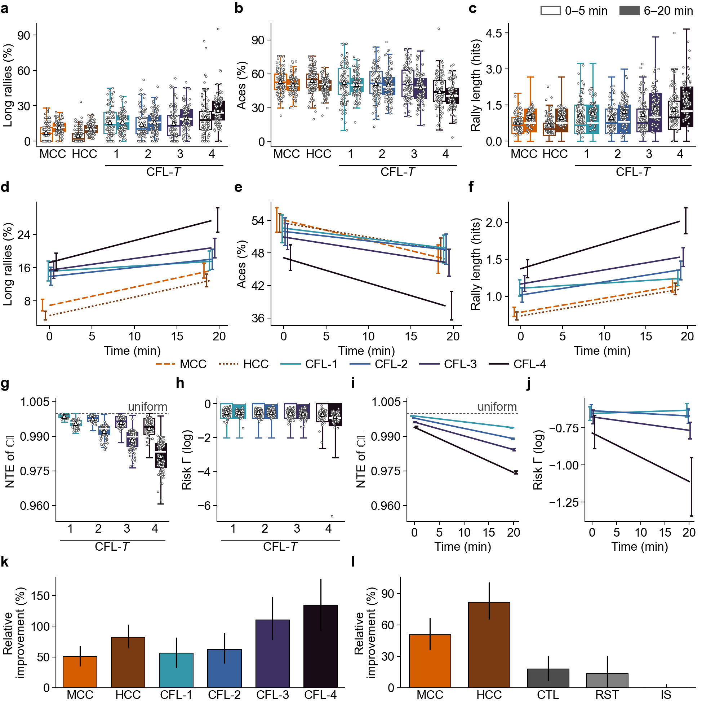
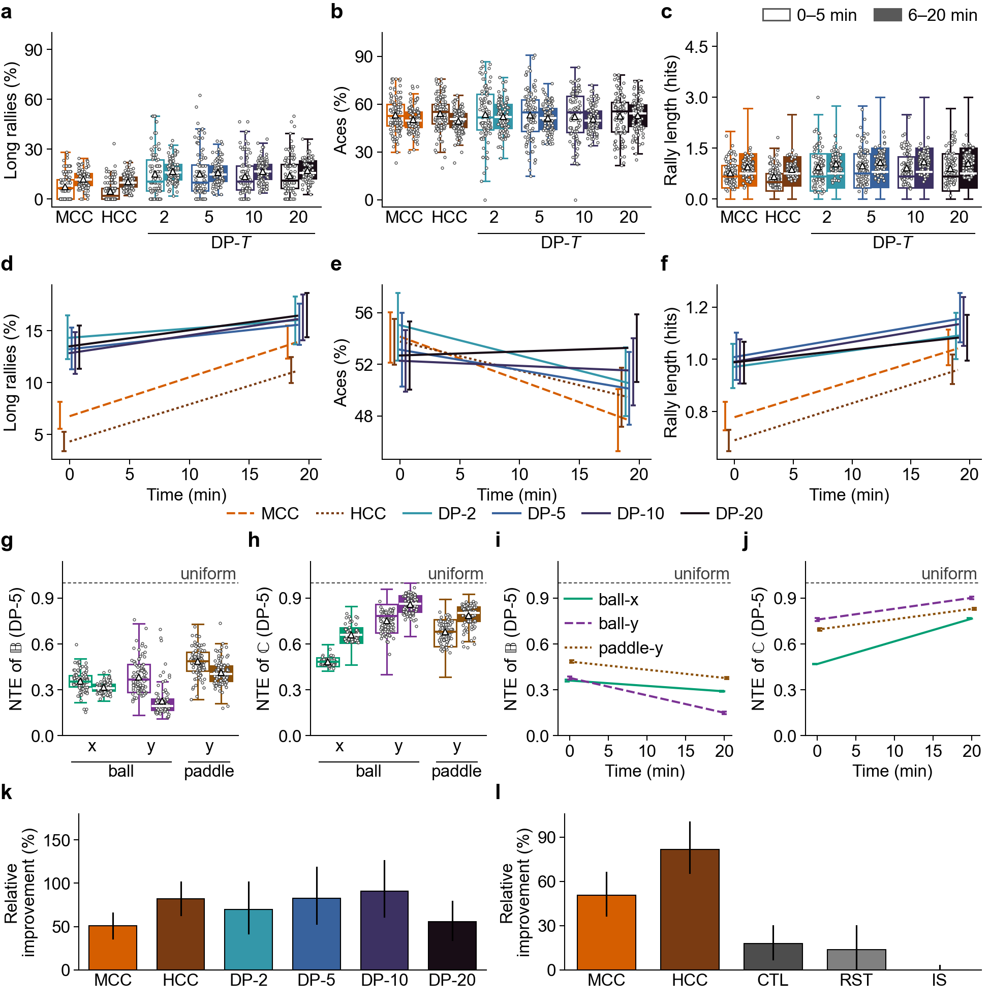
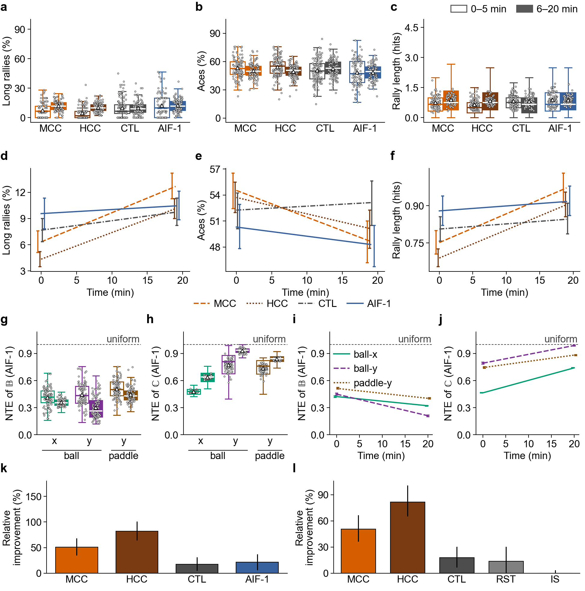

# adaptive-behaviour

Simulation and analysis code for *A memory-based active inference model of adaptive
behaviour in DishBrain-like agents*.

Three decision-making schemes are compared inside one generative model whose dimensions
match the DishBrain Pong protocol:

| Agent | Scheme | Parameter |
|---|---|---|
| `CFL-T` | counterfactual learning with a finite memory horizon | `T = 1, 2, 3, 4` |
| `AIF-1` | classical one-step active inference | — |
| `DP-T` | dynamic programming in expected free energy | `T = 2, 5, 10, 20` |

Their performance is compared against mouse and human cortical cultures (`MCC`, `HCC`)
recorded under the same protocol, and against non-active-inference controls
(`Random`, `Heuristic`, `DynaQ`, `DynaQ-replay`).

## Results

Each figure covers one agent family. Panels **a–c** are the three performance
measures (long rallies, aces, average rally length) in the first 5 minutes (open boxes)
and the last 15 (filled), with one point per session or trial, **d–f** their linear trends over a trial with 95% confidence
intervals at both ends, **g–j** the model quantities that move alongside — entropy of
the transition and state-action mappings, and the risk term — **k** relative
improvement, and **l** the in-vitro baseline, which is identical across all three for
comparison.

### Counterfactual learning, memory horizons 1–4



Short memory horizons land close to the cultures; longer ones depart from them
substantially. `CFL-4` shows the largest gain over a trial of any agent tested.

### Dynamic programming in expected free energy, planning horizons 2–20



Increasing the planning horizon confers no comparable benefit: the trend across
`T = 2, 5, 10, 20` is not significant.

### One-step active inference



`AIF-1` shows no detectable improvement in rally length over a trial.

These are exports of the three pages of `outputs/figures/fig_panels.pdf`; both come from
`adaptive_behaviour/pong/analysis/build_figures.py`.

## Layout

```
adaptive_behaviour/
  paths.py            every filesystem location, resolved from the package
  pymdp/              vendored pymdp fork, with the agents used here
  agents/             memory-based and baseline agent implementations
  pong/
    env/              Pong environment and state/observation mapping
    runners/          one script per agent; generated/ holds notebook-patched variants
    analysis/         table generators, figure data, panel drawing and page layout
    notebooks/        the six analyses, numbered in reading order
    hpc/              SLURM submission files for the published runs
results/
  published/          data behind the main results (cl, si, dpefe, experiment)
  revision/           baselines, noise sweep, planning depth, prior check
  legacy/             superseded scripts and outputs, kept as a record
outputs/              generated tables and figures, synced into the paper repo
data/private/         in-vitro recordings (not distributed)
paper-adaptive-behaviour/   the manuscript, as a submodule
```

## Install

```bash
uv sync
```

Python 3.10. All paths resolve from the package location, so scripts and notebooks
run from any working directory.

## Regenerating tables and figures

```bash
python - <<'PY'
from adaptive_behaviour.pong.analysis.tables import (
    nte_tables, noise_tables, planning_depth_table, hyperparam_table)
nte_tables.write_tables()
noise_tables.write_table()
planning_depth_table.write_table()
hyperparam_table.write_table()
PY

python adaptive_behaviour/pong/analysis/build_figures.py
```

Both write into `outputs/`. Nothing writes into the paper repository directly —
`sync_paper.py` copies `outputs/` across in one direction.

The remaining tables come from `baseline_tables` and `01_statistics.ipynb`, which read
the in-vitro recordings and so cannot run from a clone. The same holds for
`build_figures.py`, since most panels compare the agents with the cultures; the paper
repository carries the built figures.

## Data availability

`REPRODUCE.md` lists exactly which results
this covers, and what can be rebuilt without them.

## Reproducing

See [REPRODUCE.md](REPRODUCE.md), which maps every table and figure to the command
that produces it, with measured runtimes.
